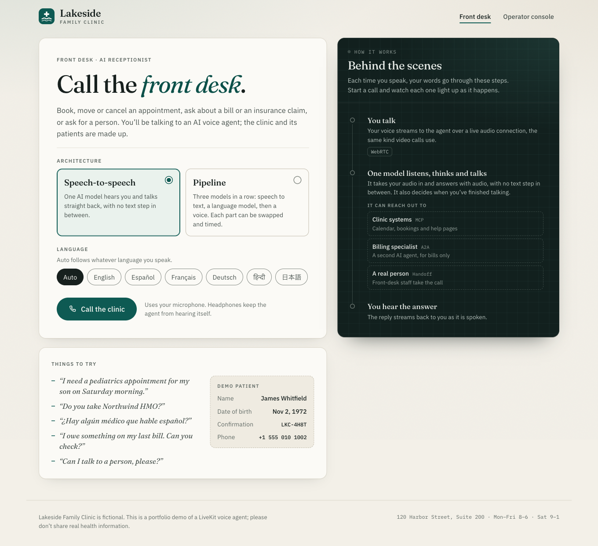
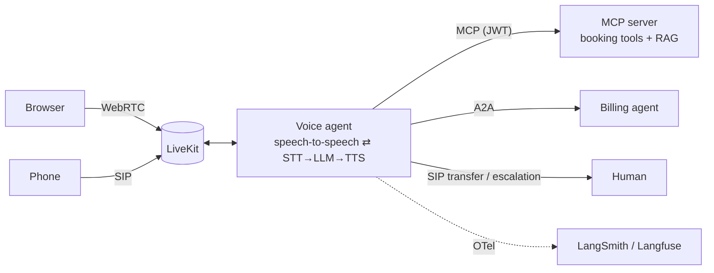
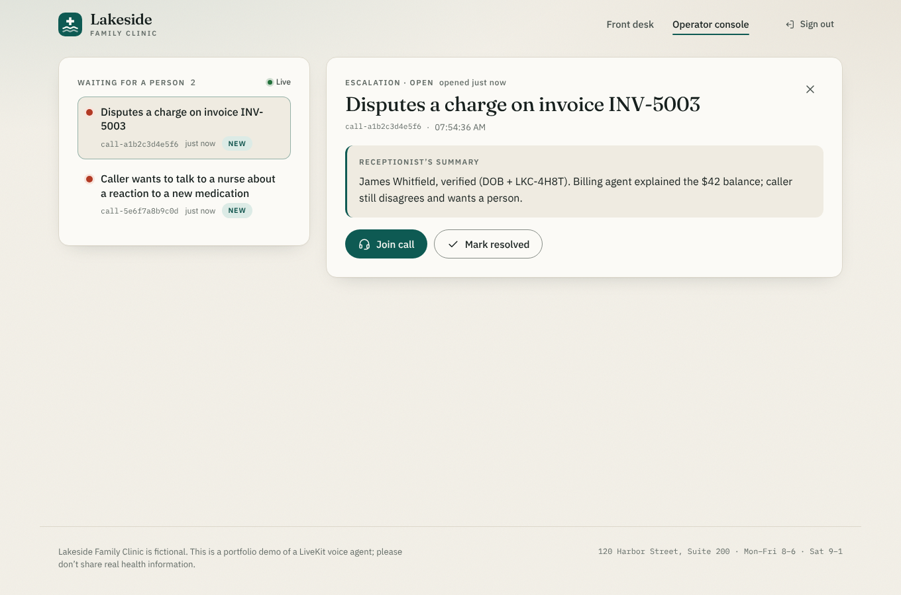

# Voice Receptionist

A voice receptionist for a (fictional) medical clinic that callers reach by **phone (SIP)** or in
the **browser (WebRTC)**. It books, reschedules and cancels appointments, answers questions from a
knowledge base, hands billing questions to a separate agent over **A2A**, and transfers the call
to a person when needed.

It runs on **two interchangeable architectures**, switchable per call:

- **speech-to-speech:** OpenAI `gpt-realtime-2`;
- **cascaded pipeline:** Deepgram → text LLM → Cartesia/ElevenLabs.

An evaluation harness compares the two on latency, cost, interruption handling and accuracy.

<p align="center">
  <picture>
    <source media="(prefers-color-scheme: dark)" srcset="docs/images/caller-dark.png">
    
  </picture>
</p>

**[Read the trade-off analysis →](docs/comparison.md)** · [Architecture](docs/architecture.md) · [Plain-language write-up on Medium](https://medium.com/@smhassanraza1/i-built-one-ai-receptionist-two-ways-then-measured-both-e21aafb09fdd)



## Highlights

- **One switch, two architectures.** `RECEPTIONIST_MODE=realtime|pipeline` (or a picker in the
  browser) selects the model path. Prompts, tools, handoffs and telemetry are shared, so the
  comparison isolates the architecture. Built on LiveKit Agents 1.8.
- **Own MCP server.** It serves seven tools over Streamable HTTP (MCP Python SDK 2.x) with a hybrid
  RAG pipeline behind `search_knowledge_base`. It is hardened with:
  - scoped JWT auth;
  - Pydantic input validation;
  - identity verification with lockout;
  - rate limiting;
  - DNS-rebinding protection;
  - a PII-masked audit log.
- **Live-call behaviour:**
  - **Barge-in and turn detection:** adaptive interruption tells "mm-hmm" from a real barge-in,
    and the semantic turn detector handles end-of-turn.
  - **Human handoff:** warm transfer, cold SIP transfer, or an operator console for browser
    calls.
  - **Multilingual support:** six languages, with the TTS following the caller's language.
- **A2A billing agent.** A separate agent (a2a-sdk 1.x) that answers account questions only for
  callers whose identity the MCP server verified, never from LLM claims. It refuses card numbers
  and offers a secure payment link instead.
- **Evaluation harness:**
  - simulated callers built from 15 personas (adversarial, multilingual, noisy);
  - an LLM judge;
  - tool-call accuracy, final-state grading through the MCP API, and handoff checks;
  - client-side **time to first audio**, **barge-in stop latency** and **backchannel
    false-interruption** probes over real WebRTC;
  - a per-call **cost model**;
  - LangSmith or Langfuse tracing over OpenTelemetry.

## Quick start

Requires Python 3.12+ with [uv](https://docs.astral.sh/uv/), Node 22, and a LiveKit project
(LiveKit Cloud, or a local `livekit-server --dev`).

```bash
make install                 # uv sync + npm ci
make download-files          # turn-detector and VAD model files, once
cp .env.example .env         # add LiveKit + provider keys
make secrets >> .env         # MCP_JWT_SECRET, BILLING_AGENT_TOKEN, INTERNAL_API_TOKEN, OPERATOR_PASSCODE
echo "MCP_AUTH_TOKEN=$(make -s token)" >> .env

make web                     # build the browser client
make mcp        &            # :8765  MCP server (booking + RAG)
make billing    &            # :8766  A2A billing agent
make webserver  &            # :8000  token server, caller UI, operator console
make agent                   # the LiveKit voice agent worker
```

- **Browser:** open <http://127.0.0.1:8000>, pick *Speech-to-speech* or *Pipeline*, and press
  Call. The operator console for human takeover is at `/operator`.
- **Terminal, no browser:** `make console`.
- **Docker:** `docker compose up --build` runs the MCP server, billing agent, web server and
  voice agent against a LiveKit Cloud project (`LIVEKIT_URL` in `.env`). The image already holds
  the model files. The agent reaches the MCP server at `http://mcp:8765/mcp`, so mint its token
  for that audience: `make token AUDIENCE=http://mcp:8765/mcp`.
- **Real phone number:** buy a Twilio or Telnyx number and run `telephony/setup_sip.py`; see
  [telephony/README.md](telephony/README.md).

### Choosing models

| Setting | Default | Notes |
|---|---|---|
| `RECEPTIONIST_MODE` | `realtime` | per-call override from the browser / SIP dispatch metadata |
| `OPENAI_REALTIME_MODEL` | `gpt-realtime-2` | `gpt-realtime-2.1` / `gpt-realtime-2.1-mini` also work |
| `RECEPTIONIST_LLM_MODEL` | `gpt-4.1-mini` | pipeline LLM; picked for low time to first token (reasoning tiers such as `gpt-5.6-luna` are slower to first token) |
| `RECEPTIONIST_REALTIME_TURN_DETECTION` | `server` | `livekit` puts LiveKit's turn detector and adaptive interruption in front of the realtime model |

### Tracing

LiveKit Agents emits OpenTelemetry spans for every turn, LLM request, tool call and handoff;
`src/receptionist/agent/telemetry.py` exports them to every backend that is configured.

- **LangSmith:** set `LANGSMITH_TRACING=true`, `LANGSMITH_API_KEY` and `LANGSMITH_PROJECT`.
  Each call becomes one trace through LangSmith's LiveKit integration (in beta), with the
  transcript, tool calls, latency and token metrics, and the call audio. Calls are grouped as
  threads by LiveKit job id and carry `mode` and `room` metadata, so you can filter by
  architecture. `LANGSMITH_RECORD_AUDIO=false` leaves the audio out. In console mode, audio
  is recorded only with `--record` (`uv run python -m receptionist.agent console --record`).
  Accounts in the EU or APAC region also set `LANGSMITH_ENDPOINT`.
- **Langfuse:** set `LANGFUSE_PUBLIC_KEY`, `LANGFUSE_SECRET_KEY` and `LANGFUSE_BASE_URL`
  (`https://cloud.langfuse.com` for EU, `https://us.cloud.langfuse.com` for US). Each call is a
  `receptionist-call` trace, with the caller's first message as input and the conversation as
  output, grouped into one session per room. Only the model requests count as generations,
  so token cost is counted once per request. `LANGFUSE_TRACING_ENVIRONMENT` (for example
  `development`) keeps test calls out of production views.
- **Any other OTLP backend:** set the standard `OTEL_EXPORTER_OTLP_*` variables.

With none of these set, tracing is off.

<details><summary>Operator console (human takeover of browser calls)</summary>

</details>

## Evaluation

```bash
make probes     # TTFA, barge-in, backchannel over WebRTC, both architectures
make eval-text  # 15 personas, judged + graded (ARCH=pipeline runs one architecture)
make eval-voice # the same personas over real audio
make cost       # modeled cost per call
make rag-eval   # retrieval quality
```

Each run writes `evals/results/<run>/summary.md`, a side-by-side table: pass rate, final-state
accuracy, tool recall and argument accuracy, judge scores and judge errors, TTFA p50/p90
(nearest-rank), the agent's measured cost per call, and what the simulator and judge cost on top.
A "–" marks a metric that doesn't apply to that run. When Langfuse keys are set, it also pushes
scored traces to Langfuse. The voice channel starts
its own local `livekit-server`, so benchmarking needs only provider keys.

**Results available without API keys** (reproduced by CI):

- **Retrieval:** Recall@3 0.957, MRR 0.911, 90% of out-of-scope questions rejected; ASR-noisy
  queries reach Recall@3 1.0. End to end 0.911: the right document in the top 3 and above the
  confidence gate, or an out-of-scope question turned away. The confidence thresholds were tuned on this same golden set, so treat these
  as an upper bound.
- **Modeled cost of a 3-minute call:**
  - pipeline $0.061 (Deepgram's multilingual model, which the default "auto" language uses;
    $0.058 with English-only nova-3);
  - gpt-realtime-2 $0.188 with caching, $0.562 without.
- **Voice-harness accuracy against a synthetic agent with known timing:** TTFA reads 862 ms for a
  700 ms agent, the difference being WebRTC transport in both directions; barge-in detection 3/3,
  with ±10 ms spread.

**Measured head-to-head** (2026-10-26, pipeline vs `gpt-realtime-2.1-mini`; details and caveats
in [docs/comparison.md](docs/comparison.md#measured-results)):

- **15 personas, graded on database state and by an LLM judge:** pipeline 13/15, speech-to-speech
  12/15. The one real agent error was the realtime model double-booking a reschedule.
- **Time to first audio over WebRTC, p50:** pipeline 4.0 s, speech-to-speech 1.9 s, mostly
  because the realtime model says "let me check" while its tool call runs.
- **Interruptions:** both stopped for every barge-in (about 1 s) and ignored every "mm-hmm".

## Testing

```bash
make test    # offline: no API keys needed
```

The suite covers the following, all offline:

- **MCP server:** booking logic, auth, validation, lockout, rate limits, RAG.
- **Billing agent:** A2A protocol, identity rules, card masking, multi-turn context.
- **Web server:** tokens, escalations, operator auth.
- **Voice agent:** both architecture builds, identity capture, event redaction, handoffs, the A2A
  billing handoff inside a real `AgentSession`.
- **Evals:** scoring, judge gate, cost model.
- **End-to-end:** the agent drives the real MCP, billing and web servers as subprocesses over
  HTTP with JWT auth, and the run is graded on database state. It uses scripted models.
- **Voice harness:** measurement accuracy against a live local LiveKit server.

## Project layout

```
src/receptionist/
  agent/          LiveKit voice agent: pipelines.py (the architecture switch), agents.py, handoff.py,
                  tools.py (MCP), events.py (browser telemetry), multilingual.py, speech.py, telemetry.py
  mcp_server/     MCP server: server.py, db.py, auth.py, security.py, validation.py, rag/
  billing_agent/  A2A billing agent: server.py, executor.py, rules.py, llm.py, client.py
  web/            token server, escalations, operator console API, static hosting
  evals/          simulator, judge, scoring, outcomes, cost model, text + voice runners, reports
  common/         shared clock and fictional seed data
web/              React + TypeScript client (caller UI, operator console)
telephony/        SIP trunk + dispatch rule, setup script, phone-number guide
evals/            scenarios/*.yaml (personas), probes.yaml
data/kb/          knowledge-base documents
docs/             comparison, architecture, contracts, research
```

## Stack

LiveKit Agents 1.8 · OpenAI Realtime (`gpt-realtime-2`) · Deepgram Nova-3 · Cartesia Sonic-3 / ElevenLabs Flash v2.5 · MCP Python SDK 2.3 · a2a-sdk 1.2 ·
OpenTelemetry + LangSmith / Langfuse · SQLite · Starlette · React 19 + Vite · uv · GitHub Actions.

All names, phone numbers and records are fictional. This is a portfolio project, not medical
software.
