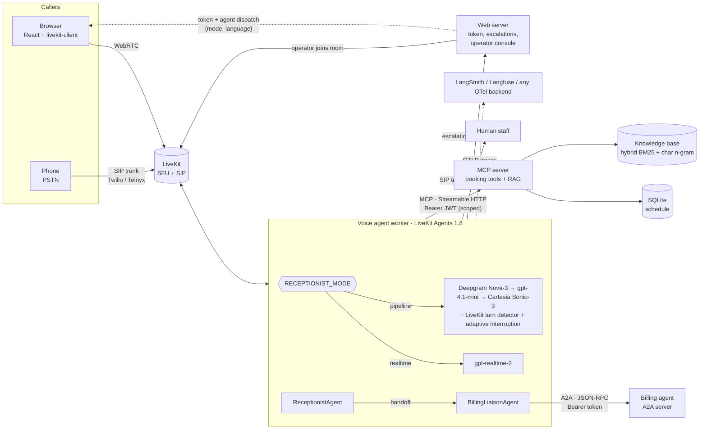

# Architecture

## Components

| Component | Code | What it does |
|---|---|---|
| Voice agent | `src/receptionist/agent/` | One `AgentSession` per call. `pipelines.py` builds either architecture from one setting; everything else (prompts, tools, handoffs, telemetry) is shared, so the comparison isolates the audio/model path. |
| MCP server | `src/receptionist/mcp_server/` | Booking, rescheduling, cancelling, provider search and knowledge-base search over MCP (Python SDK 2.x, Streamable HTTP). JWT auth with per-tool scopes, input validation, rate limiting, identity lockout, PII-masked audit log. |
| RAG | `src/receptionist/mcp_server/rag/` | Markdown-aware chunking, BM25 + character n-gram TF-IDF fused with reciprocal rank fusion, optional dense ranker, confidence gate that returns "no confident match" instead of a guess. |
| Billing agent | `src/receptionist/billing_agent/` | A separate agent behind the A2A protocol (a2a-sdk 1.x). Answers balance, invoice, claim and payment-plan questions for verified patients; never takes card numbers. |
| Web server | `src/receptionist/web/` | Issues LiveKit tokens that dispatch the agent with per-call settings, receives escalations, serves the caller UI and the operator console. |
| Browser client | `web/` | Architecture and language picker, live transcript, per-turn latency, tool-call timeline, handoff banners; operator console for human takeover. |
| Telephony | `telephony/` | Inbound SIP trunk + dispatch rule (JSON and an idempotent setup script) for a real phone number. |
| Evals | `src/receptionist/evals/`, `evals/` | Persona simulator, LLM judge, tool-call accuracy, final-state grading, voice probes (TTFA, barge-in, backchannel), cost model, Langfuse export. |

## A call, end to end

1. The browser asks `POST /api/token` with `{mode, language}`. The token carries a
   `RoomConfiguration` that dispatches the agent (`AGENT_NAME`, default `receptionist`) with that
   JSON as job metadata. A phone
   call takes the same path through a SIP dispatch rule.
2. The worker parses the metadata into a `CallConfig` (whitelisted values only), builds the session
   for that architecture and connects the MCP toolset with its bearer token.
3. Each turn, the agent may call MCP tools. Results come back as compact JSON. When a
   `lookup_appointments` or `book_appointment` result says `identity_verified`, the
   **server-verified** patient id is stored in the call state. Nothing the LLM says can set it.
4. Billing questions hand the call to `BillingLiaisonAgent`, which forwards them over A2A with the
   verified patient id and one A2A `context_id` per call.
5. A request for a person files an escalation (browser) or transfers the SIP leg (warm with a
   briefing, or cold via SIP REFER). When an `operator-*` participant joins, the agent says goodbye
   and leaves; the room stays open. If a SIP transfer fails, the agent says so and stays on the
   call.
6. Throughout, the agent publishes `turn_metrics`, `tool_call`, `interruption` and `handoff` events
   on the data channel (PII-redacted), then a `usage` summary when the session closes. It exports
   OpenTelemetry spans, one trace per call, to LangSmith, Langfuse or any OTLP backend.
7. The call ends when the caller hangs up, after `RECEPTIONIST_MAX_CALL_SECONDS` (default 10
   minutes), or when a check-in after 20 seconds of silence goes unanswered.

## Security model

| Threat | Control |
|---|---|
| Someone calls the MCP server directly | HS256 JWT with issuer, audience = server URL, expiry and scopes (`kb:read`, `appointments:read`, `appointments:write`), checked per tool. DNS-rebinding protection via allowed hosts. Body-size limit. |
| Account enumeration / guessing | Identity = date of birth + confirmation code or phone on file. Mismatches return one generic error and count toward a lockout per MCP session (one phone call). Rate limiting per token subject bounds how many sessions a client can open. |
| Booking onto someone else's record | A booking joins an existing patient record only on a full match of name, date of birth and phone; anything less creates a new record and says nothing about partial matches. |
| The LLM is talked into acting for another patient | The billing handoff uses the identity captured from verified tool results, never LLM arguments. Prompt-injection and social-engineering scenarios are in the eval suite. |
| Prompt injection through knowledge-base text | Retrieved text is labelled as data in the tool schema and prompt, stripped of control characters and length-capped. |
| Bad tool arguments | Pydantic `Annotated[..., Field(...)]` constraints reject malformed input before handlers run; semantic validation normalises phones (E.164), names, dates of birth and date windows. |
| Card numbers spoken on a call | The billing agent masks any 13–19 digit run before it is stored and offers a secure payment link instead. |
| PII in logs and the browser | The audit log masks phone, DOB and names and records confirmation codes as HMAC fingerprints; browser events redact tool arguments. |
| Untrusted dispatch metadata | `CallConfig.from_metadata` accepts only whitelisted modes and languages. |
| Service-to-service calls | Billing agent: bearer token (constant-time compare), declared in its A2A agent card; its tasks expire and can't be listed. Escalations: `X-Internal-Token`. |
| Web endpoints | JSON-only `POST`s (no cross-site form posts), a Content-Security-Policy on the client, per-IP rate limits, and separate lockouts for the operator passcode and the agent's internal token. |
| Runaway or abandoned calls | A hard cap on call length and a silence check-in end calls nobody is on, so an open tab can't keep the models running. |
